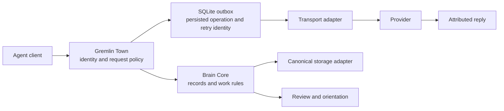

# Architecture

Exosuit separates durable facts and deterministic rules from agent interaction. A language model may interpret a conversation or propose work. It does not become the authority for identity, access, publication or completion merely by describing those things.

## Brain Core

`components/brain-core/src/brain_core/` owns record validation, provenance, ownership, current-version interpretation and deterministic work readers. Its functions operate on supplied records and explicit inputs. The core has no model inference dependency.

`github_storage.py` implements durable record publication against a GitHub-backed store. Publication and reconciliation are separate operations: a lost response cannot safely be treated as proof that nothing was written. Unit tests inject accepted-but-lost replies and conflicting operations.

`work.py`, `review.py` and `orientation.py` interpret the record model, explain task state and assemble views. The review functionality called Ciel lives within these packages; there is no third Ciel service in this repository.

## Gremlin Town

`components/gremlin-town/src/gremlin_town/` supplies authentication, policy, request state, SQLite persistence, an outbox worker and transport adapters. Participants and project grants bound who can exchange which requests. Packet text is content, not an authorization grant.

The worker checks permission around dispatch, persists the operation and exact payload, and reuses its retry identity. An ambiguous provider response moves into reconciliation rather than an unqualified resend. Provider acceptance, work in progress and a returned result remain distinct states. A result being returned does not by itself establish that its contents are correct.

The MCP and local project interfaces expose governed operations. Optional dashboard, review-card, calendar, mail and scheduler modules use the same record and request boundaries. The showcase demo keeps those external integrations disconnected.

## What to inspect

| Concern | Source | Evidence to read |
|---|---|---|
| Accepted message with a lost reply | GT `workers/outbox.py` | GT `tests/backend/test_backend.py` |
| Authorization changes during dispatch | GT policy and outbox | Backend authorization/race cases |
| Lost canonical publication receipt | BC `github_storage.py` | BC `tests/unit/test_github_storage.py` |
| Meaning of task state and next step | BC `work.py` | BC `tests/unit/test_work_reader.py` |
| Record parsing and owner boundaries | BC `records.py`, `ownership.py` | BC record/ownership tests |

These are inspection pointers, not a claim that every failure mode is covered. Large interpretation and storage modules remain a maintenance cost. The validation record separates tested local behavior from optional integrations and design concepts.
